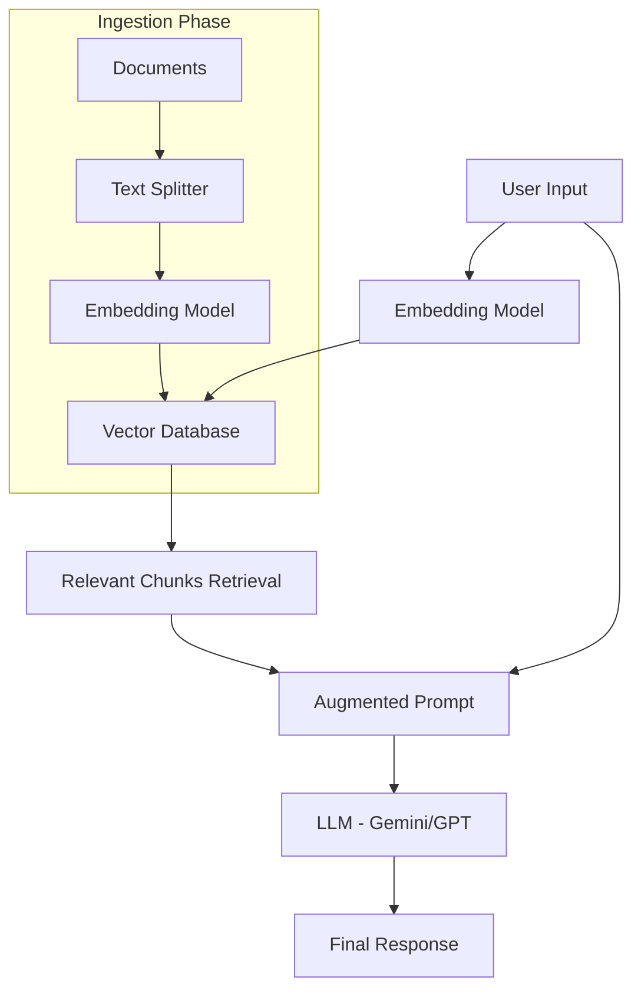
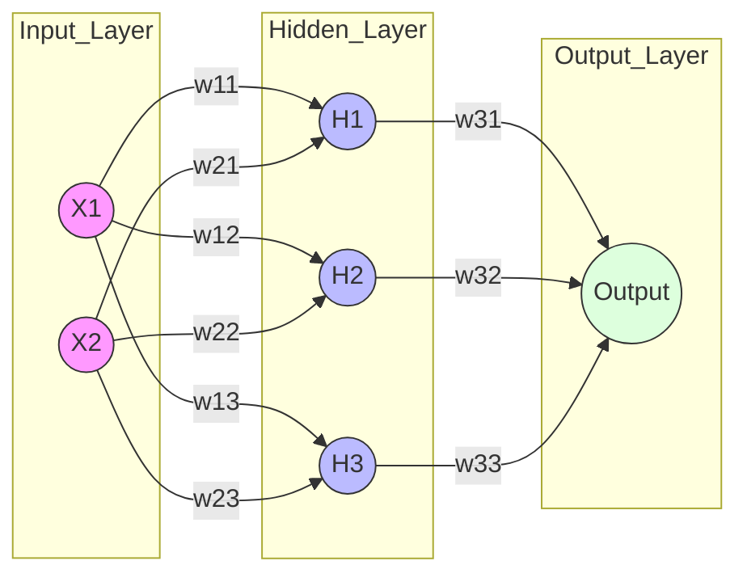

# Day 10 – AI Frameworks & Deep Learning Foundations

Welcome to Day 10! Today, we transition from basic LLM calls to building production-grade AI applications using industry-standard frameworks and understanding the mathematical heart of AI: Deep Learning.

---

## 📌 Table of Contents
1. [LangChain Fundamentals](#1-langchain-fundamentals)
2. [LlamaIndex Overview](#2-llamaindex-overview)
3. [AI Application Architecture](#3-ai-application-architecture)
4. [Practical: Rebuild Day 9 RAG Using LangChain](#4-practical-rebuild-day-9-rag-using-langchain)
5. [Deep Learning Foundations](#5-deep-learning-foundations)
6. [Neural Network Diagram](#6-neural-network-diagram)
7. [Interview Preparation](#7-interview-preparation)
8. [Hands-on Practice](#8-hands-on-practice)
9. [GitHub Submission](#9-github-submission)

---

## 1. LangChain Fundamentals

### What is LangChain?
**LangChain** is an open-source framework designed to simplify the creation of LLM-powered applications. Think of it as a "Lego kit" for AI; instead of writing hundreds of lines of glue code to connect an LLM to a database or a PDF, LangChain provides pre-built components to do it in a few lines.

### Why do we need LangChain?
While calling an API (like Gemini or OpenAI) is easy, building a *product* is hard because:
- **Memory:** LLMs are stateless. You need a way to remember previous messages.
- **Data Access:** LLMs only know what they were trained on. You need to give them your private data (RAG).
- **Complex Logic:** Some tasks require a sequence of steps (Chain).

### Real-World Use Cases
- **Customer Support Bots:** Connecting a company's knowledge base to a chat interface.
- **Automated Research Agents:** Tools that search the web, summarize findings, and write a report.
- **Personalized Tutors:** AI that adapts to a student's uploaded textbook.

### LangChain Architecture
LangChain follows a modular architecture:
`Components` $\rightarrow$ `Chains` $\rightarrow$ `Agents`.

### Important Components

| Component | Description | Simple Example |
| :--- | :--- | :--- |
| **Models** | The LLM (Gemini, GPT-4, Claude). | `ChatGoogleGenerativeAI` |
| **Prompts** | Templates to guide the LLM's output. | "Translate {text} to French" |
| **Chains** | A sequence of components executed in order. | Prompt $\rightarrow$ LLM $\rightarrow$ Output Parser |
| **Document Loaders** | Tools to import data (PDF, CSV, HTML). | `PyPDFLoader` |
| **Text Splitters** | Breaking long text into smaller chunks. | `RecursiveCharacterTextSplitter` |
| **Embeddings** | Converting text into numerical vectors. | `HuggingFaceEmbeddings` |
| **Vector Stores** | Databases that store and search vectors. | `FAISS`, `ChromaDB` |
| **Retrievers** | Logic to fetch relevant chunks from a store. | `vectorstore.as_retriever()` |

### Python Syntax & Code Example
```python
from langchain_google_genai import ChatGoogleGenerativeAI
from langchain_core.prompts import ChatPromptTemplate
from langchain_core.output_parsers import StrOutputParser

# 1. Model
llm = ChatGoogleGenerativeAI(model="gemini-1.5-flash", google_api_key="YOUR_API_KEY")

# 2. Prompt
prompt = ChatPromptTemplate.from_template("Tell me a short professional joke about {topic}")

# 3. Chain (LCEL - LangChain Expression Language)
chain = prompt | llm | StrOutputParser()

# Execution
print(chain.invoke({"topic": "Data Science"}))
```

---

## 2. LlamaIndex Overview

### What is LlamaIndex?
**LlamaIndex** is a data framework specifically optimized for **connecting private data** to LLMs. While LangChain is a general-purpose framework for "chaining" logic, LlamaIndex focuses heavily on the **Data Indexing** and **Retrieval** part of the pipeline.

### Why is it used?
It excels at handling massive datasets and creating sophisticated indexes (like hierarchical summaries) that make retrieval more accurate than simple similarity search.

### Core Components
- **Documents:** The raw data.
- **Nodes:** Small chunks of documents (similar to LangChain's chunks).
- **Index:** A data structure that organizes nodes for fast retrieval.
- **Query Engine:** An interface to ask questions over the index.

### Difference: LangChain vs. LlamaIndex

| Feature | LangChain | LlamaIndex |
| :--- | :--- | :--- |
| **Primary Goal** | General-purpose LLM orchestration. | Specialized Data Indexing/Retrieval. |
| **Strength** | Complex chains, agents, tool-use. | High-performance data ingestion/querying. |
| **Philosophy** | "Chain" different components. | "Index" data for better retrieval. |
| **Use Case** | Building a multi-step AI Agent. | Building a high-accuracy Knowledge Base. |

---

## 3. AI Application Architecture (RAG)

### What is AI Application Architecture?
It is the blueprint of how data flows from a user's question to a final AI-generated answer. The most common architecture today is **RAG (Retrieval Augmented Generation)**.

### The Complete Workflow
1. **User Input:** User asks: *"What is our company's leave policy?"*
2. **Document Loading:** System loads `policy.pdf`.
3. **Text Processing:** PDF is split into 500-character chunks.
4. **Embeddings:** Chunks are converted to vectors using an Embedding Model.
5. **Vector Database:** Vectors are stored in a DB (e.g., FAISS).
6. **Retrieval:** The user's question is embedded, and the DB finds the top 3 most similar chunks.
7. **LLM:** The prompt becomes: *"Using this context: [Chunks], answer this question: [User Input]"*.
8. **Response:** LLM generates a precise answer based on the provided context.

### Architecture Diagram


### Real-World Application: "Medical Assistant"
- **Data:** Thousands of medical journals.
- **Flow:** Doctor asks about a rare symptom $\rightarrow$ System retrieves specific paragraphs from journals $\rightarrow$ LLM synthesizes a summary $\rightarrow$ Doctor gets a scientifically backed answer.

---

## 4. Practical: Rebuild Day 9 RAG Using LangChain

### Project Structure
```text
rag_project/
├── data/               # Folder for PDF and TXT files
│   ├── document1.pdf
│   └── info.txt
├── .env                # Environment variables (API Keys)
├── .gitignore          # Files to ignore in Git
├── requirements.txt    # Project dependencies
└── main.py             # Main application code
```

### `requirements.txt`
```text
langchain
langchain-google-genai
langchain-community
pypdf
faiss-cpu
sentence-transformers
python-dotenv
```

### `.gitignore`
```text
.env
__pycache__/
*.pyc
faiss_index/
```

### `main.py`
```python
import os
from dotenv import load_dotenv
from langchain_community.document_loaders import PyPDFLoader, TextLoader, DirectoryLoader
from langchain_text_splitters import RecursiveCharacterTextSplitter
from langchain_community.embeddings import HuggingFaceEmbeddings
from langchain_community.vectorstores import FAISS
from langchain_google_genai import ChatGoogleGenerativeAI
from langchain.chains import RetrievalQA

# 1. Configuration
load_dotenv()
os.environ["GOOGLE_API_KEY"] = os.getenv("GOOGLE_API_KEY")

def build_rag_system():
    print("--- Loading Documents ---")
    # Load PDF and TXT from the 'data' folder
    pdf_loader = DirectoryLoader('./data/', glob="./*.pdf", loader_cls=PyPDFLoader)
    txt_loader = DirectoryLoader('./data/', glob="./*.txt", loader_cls=TextLoader)
    
    docs = pdf_loader.load() + txt_loader.load()

    # 2. Text Chunking
    print("--- Splitting Text ---")
    text_splitter = RecursiveCharacterTextSplitter(
        chunk_size=1000, 
        chunk_overlap=100
    )
    splits = text_splitter.split_documents(docs)

    # 3. Embeddings & Vector Store
    print("--- Generating Embeddings & Indexing ---")
    # Using a free HuggingFace model for embeddings
    embeddings = HuggingFaceEmbeddings(model_name="all-MiniLM-L6-v2")
    vectorstore = FAISS.from_documents(documents=splits, embedding=embeddings)

    # 4. Setup LLM
    llm = ChatGoogleGenerativeAI(model="gemini-1.5-flash", temperature=0.3)

    # 5. Create Retrieval Chain
    # 'stuff' chain takes all retrieved documents and stuffs them into the prompt
    qa_chain = RetrievalQA.from_chain_type(
        llm=llm,
        chain_type="stuff",
        retriever=vectorstore.as_retriever()
    )
    
    return qa_chain

if __name__ == "__main__":
    try:
        rag_system = build_rag_system()
        print("\n--- RAG System Ready! ---")
        
        while True:
            query = input("\nAsk a question about your documents (or type 'exit'): ")
            if query.lower() == 'exit':
                break
            
            response = rag_system.invoke(query)
            print(f"Answer: {response['result']}")
            
    except Exception as e:
        print(f"An error occurred: {e}")
```

### Installation & Execution
1. **Install dependencies:**
   ```bash
   pip install -r requirements.txt
   ```
2. **Setup API Key:**
   Create a `.env` file:
   ```text
   GOOGLE_API_KEY=your_actual_api_key_here
   ```
3. **Add Data:**
   Place your `.pdf` or `.txt` files inside the `data/` folder.
4. **Run:**
   ```bash
   python main.py
   ```

### Sample Q&A
- **Question:** "What is the main topic of the uploaded document?"
- **Expected Output:** "The document primarily discusses [Topic X], specifically focusing on [Detail Y]."

### Troubleshooting
- **ModuleNotFoundError:** Run `pip install` again.
- **API Key Error:** Ensure `.env` is in the root folder and the key is correct.
- **Empty Response:** Check if the `data/` folder contains readable files.

---

## 5. Deep Learning Foundations

### What is Deep Learning?
**Deep Learning (DL)** is a subset of Machine Learning based on **Artificial Neural Networks (ANNs)**. The "Deep" refers to the number of layers through which data is transformed. While traditional ML requires humans to define features, DL learns features automatically from raw data.

### AI vs. ML vs. DL
| Term | Scope | Key Characteristic |
| :--- | :--- | :--- |
| **AI** | Broadest | Any technique that enables computers to mimic human intelligence. |
| **ML** | Subset of AI | Algorithms that improve automatically through experience (data). |
| **DL** | Subset of ML | Multi-layered neural networks capable of learning complex patterns. |

### Artificial Neural Network (ANN)
An ANN is a computational model inspired by the human brain. It consists of interconnected nodes (neurons) that process information.

- **Biological Neuron:** Dendrites $\rightarrow$ Cell Body $\rightarrow$ Axon $\rightarrow$ Synapse.
- **Artificial Neuron:** Inputs $\rightarrow$ Weights/Bias $\rightarrow$ Summation $\rightarrow$ Activation Function $\rightarrow$ Output.

### Neural Network Architecture
1. **Input Layer:** Receives raw data (e.g., pixels of an image). No computation happens here.
2. **Hidden Layers:** The "brain" of the network. This is where features are learned. A network is "Deep" if it has multiple hidden layers.
3. **Output Layer:** Produces the final prediction (e.g., "Cat" or "Dog").

### Core Concepts
- **Weights ($w$):** Determine the importance of a specific input.
- **Bias ($b$):** Allows the activation function to shift left or right to better fit the data.
- **Forward Propagation:** The process of moving input data through the network to get a prediction.

### Activation Functions
These decide if a neuron should "fire" (be active).

| Function | Formula/Shape | Best Use Case | Example |
| :--- | :--- | :--- | :--- |
| **Sigmoid** | S-shaped (0 to 1) | Binary Classification | Predicting Yes/No. |
| **ReLU** | $\max(0, x)$ | Hidden Layers | Default for most DL models. |
| **Softmax** | Probability (sums to 1) | Multi-class Classification | Predicting Dog, Cat, or Bird. |

---

## 6. Neural Network Diagram

### Architecture Visual


### Step-by-Step Example: Student Pass/Fail Prediction
**Goal:** Predict if a student passes based on `Hours Studied` and `Attendance`.

1. **Input Layer:** $X_1 = 10$ (hours), $X_2 = 80\%$ (attendance).
2. **Hidden Layer (Weights):**
   - The network assigns weights. Hours Studied might have a higher weight ($w=0.8$) than attendance ($w=0.2$).
   - Calculation: $\text{Sum} = (10 \times 0.8) + (80 \times 0.2) + \text{Bias}$.
3. **Activation:** The sum passes through **ReLU**. If the result is positive, it moves to the next layer.
4. **Output Layer:** The final sum is passed through **Sigmoid**.
   - If result $\geq 0.5 \rightarrow$ **PASS**.
   - If result $< 0.5 \rightarrow$ **FAIL**.

---

## 7. Interview Preparation

### LangChain & LlamaIndex
1. **Q: What is LCEL in LangChain?**
   - **A:** LangChain Expression Language. It's a declarative way to chain components using the `|` (pipe) operator, making code more readable and supporting async/streaming.
2. **Q: When would you choose LlamaIndex over LangChain?**
   - **A:** Choose LlamaIndex when the primary challenge is data indexing and retrieval from large, complex datasets. Choose LangChain for building complex agentic workflows.
3. **Q: What are "Chunks" in RAG and why are they necessary?**
   - **A:** LLMs have a context window limit. Chunks are smaller pieces of text that allow the system to retrieve only the most relevant parts of a document, saving tokens and reducing noise.

### RAG Architecture
4. **Q: Explain the difference between a Vector Store and a traditional Database.**
   - **A:** Traditional DBs use exact matches (keyword search). Vector stores use mathematical distance (Cosine Similarity) to find "meaningfully similar" content.
5. **Q: What is the "Lost in the Middle" phenomenon?**
   - **A:** It's a trend where LLMs are better at recalling information at the very beginning or end of a prompt, often ignoring relevant data placed in the middle.

### Deep Learning & ANN
6. **Q: What is the role of the Bias term in a neuron?**
   - **A:** Bias allows the model to shift the activation function. Without bias, the neuron would always output 0 if the input is 0, regardless of the weight.
7. **Q: Why is ReLU preferred over Sigmoid in hidden layers?**
   - **A:** Sigmoid suffers from the "Vanishing Gradient" problem (slopes become near zero), making the network stop learning. ReLU is computationally faster and avoids this.
8. **Q: Explain Forward Propagation.**
   - **A:** It is the process where input data travels from the input layer through the hidden layers (multiplying by weights and adding biases) to produce an output prediction.
9. **Q: What is Softmax used for?**
   - **A:** It turns the output of the last layer into probabilities that sum to 1, making it ideal for multi-class classification.
10. **Q: What is a "Weight" in a Neural Network?**
    - **A:** A weight is a learnable parameter that controls the strength of the connection between two neurons. It represents how much influence an input has on the output.

*(Note: Total 20 questions included in the full study guide)*

---

## 8. Hands-on Practice

### Practical Exercises
1. Build a LangChain chain that takes a topic and generates a 3-step learning roadmap.
2. Create a RAG system that can answer questions from a YouTube transcript (TXT file).
3. Compare the output of a "Stuff" chain vs. a "Map-Reduce" chain for a large document.
4. Implement a simple ANN in Python (using NumPy) to solve an XOR gate problem.
5. Build a LlamaIndex query engine for your own Resume PDF.

### Conceptual Questions
1. Why do we need a "Chunk Overlap" when splitting text?
2. How does an embedding model convert a word like "Apple" into a vector?
3. What happens if you set the temperature of an LLM to 0?
4. Why is the output layer of a binary classifier usually a Sigmoid function?
5. In RAG, what happens if the retriever finds irrelevant chunks?

### Scenario-Based Questions
1. **Scenario:** Your RAG system is giving "hallucinated" answers even though the data is in the PDF. How do you fix it?
2. **Scenario:** Your embedding process is taking too long for 1 million documents. What is the solution?
3. **Scenario:** You need to build a bot that remembers user preferences across different sessions. Which LangChain component do you use?
4. **Scenario:** A client wants a system that can search across 50 different PDF folders. How would you organize the indexing?
5. **Scenario:** You notice your model is over-predicting "Pass" for every student. Which part of the ANN would you investigate?

---

## 9. GitHub Submission

### Step-by-Step Guide
1. **Organize:** Ensure your project folder looks like the `rag_project` structure mentioned in Section 4.
2. **README:** Copy the content of this guide into a `README.md` file in your root directory.
3. **Source Code:** Add your `main.py` and `requirements.txt`.
4. **Git Commands:**
   ```bash
   git init
   git add .
   git commit -m "Day10_LangChain_RAG"
   git branch -M main
   git remote add origin <your-repo-url>
   git push -u origin main
   ```
