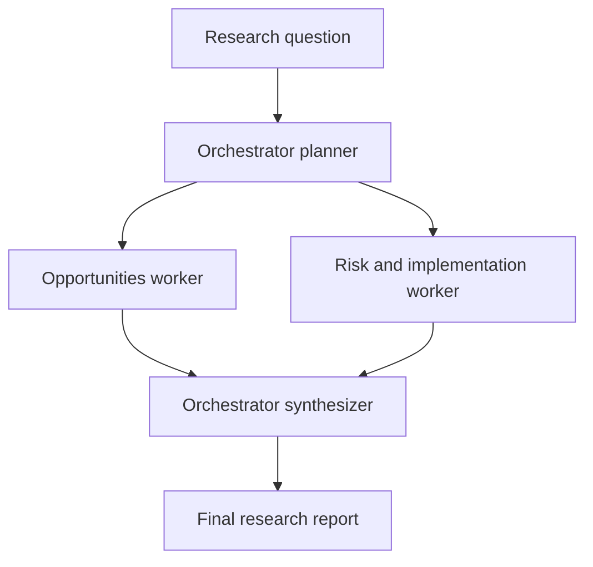

# Day 13 - Multi-Agent Systems I

## Orchestrator vs. worker agents

This submission demonstrates a LangChain multi-agent workflow. An orchestrator plans work for a research question, delegates complementary tasks to two specialized worker agents, runs those workers in parallel, and consolidates their outputs into a final report.

### Workflow



### Files

- `Day13_Orchestrator_Worker_Agents.ipynb` - setup, planning, worker delegation, parallel execution, synthesis, and report generation.
- `outputs/final_research_report.txt` - generated when the notebook's final section runs successfully.

## Run the notebook

The project dependencies are declared in `..\pyproject.toml`. From PowerShell:

```powershell
cd E:\Ivoyant\WEEK3\DAY13
uv sync
```

If PowerShell still cannot find `uv`, add its install folder to this terminal's `PATH`:

```powershell
$env:Path = "$env:USERPROFILE\.local\bin;$env:Path"
uv sync
```

Open `langchain_updated\Day13_Orchestrator_Worker_Agents.ipynb` in VS Code and select the `DAY13\.venv` Python environment as the notebook kernel. Run the cells from top to bottom.

## Groq API key

The notebook uses LangChain's `langchain-groq` integration and loads `GROQ_API_KEY` from `E:\Ivoyant\WEEK3\DAY13\.env` (or from the process environment). Add your Groq key to that local `.env` file if needed:

```text
GROQ_API_KEY=your_key_here
```

Do not commit or share the `.env` file or your API key. The repository's `.gitignore` already excludes `.env` files.

## Notes

- The example defaults to Groq's `llama-3.3-70b-versatile` model. Set `GROQ_MODEL` in the environment to choose another Groq-supported model.
- The notebook makes separate planning, worker, and synthesis requests. Groq account limits and pricing may apply.
- No web-search tool is configured. The workers produce model-generated analysis, not live research; verify claims against trusted sources before relying on them.
- Running the last notebook cell creates the `outputs` folder and writes the consolidated report.
