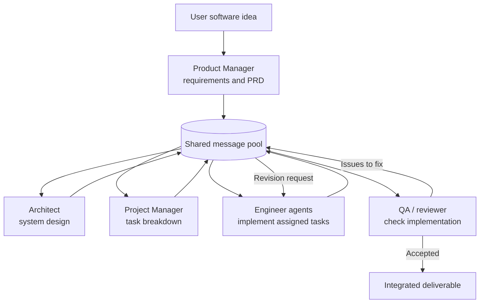

# Day 14 - Multi-Agent Systems II

## Real-world multi-agent architecture case studies

These are real, published multi-agent systems and research frameworks. They
demonstrate practical architecture patterns; this comparison does not imply
that either system is deployed in every production setting.

## Case study 1: MetaGPT - a software company made of agents

MetaGPT models a small software team with specialized roles and a shared
Standard Operating Procedure (SOP). A product manager turns a request into
requirements, an architect designs the system, a project manager breaks work
into tasks, and engineers implement the tasks. A QA role can review the result.
Agents publish and consume structured messages through a shared message pool,
so their work is coordinated by role and artifacts rather than by one
unstructured conversation.

**Why it is useful:** The explicit workflow and intermediate artifacts (such
as requirements, designs, and task lists) make responsibilities and handoffs
easier to inspect. This is a good fit for work that can be divided into
well-defined stages.

**Trade-offs:** A staged workflow can be slower or more rigid when requirements
change frequently. Poorly specified handoffs can also propagate errors to every
later role, so intermediate outputs need validation.

### Agent communication flow

The diagram is a simplified view of the paper's software-development SOP. The
shared message pool represents the message-based coordination mechanism; the
arrows show the main sequence of work, not the only messages agents can exchange.

### Where this could apply to a class project

**Idea: Campus Event Planner.** Given a class event brief, the agents could
produce a feasible event plan:

1. A coordinator extracts the event's goals, audience, date, and constraints.
2. Venue and schedule agents propose options and record availability.
3. A budget agent estimates costs using a supplied price list.
4. A reviewer checks the plan against budget, timing, and accessibility
   constraints, then requests revisions when needed.
5. The coordinator combines the approved outputs into a final plan.

This reuses MetaGPT's specialist roles, staged artifacts, and review loop. A
class prototype can keep agents read-only and use mock venue and pricing data;
the reviewer can enforce simple, testable rules before the plan is presented.

## Case study 2: AutoGen - agents that collaborate through conversation

AutoGen is an open-source framework for building applications in which
conversable agents exchange messages, invoke tools, and follow configurable
conversation patterns. An application can pair an assistant with a user-proxy
agent that executes approved tools, or use group chat with a manager to select
which agent speaks next. The conversation can end when the task is complete or
when a configured termination condition is reached.

**Why it is useful:** Conversation-based coordination supports flexible
back-and-forth problem solving and tool use. The framework lets developers
choose how agents are composed rather than requiring one fixed role sequence.

**Trade-offs:** More conversation can mean more model calls, cost, and latency.
Without clear speaker-selection and stopping rules, agents may repeat work or
fail to converge. Tool permissions and outputs also need validation.

## Comparison and takeaway

| Aspect | MetaGPT | AutoGen |
| --- | --- | --- |
| Coordination style | Role-based workflow with shared messages and artifacts | Configurable agent conversations, including group chat |
| Best fit | Tasks with recognizable stages and handoffs | Tasks needing flexible discussion, tool use, or iterative reasoning |
| Main control point | SOP and role responsibilities | Conversation orchestration and termination conditions |
| Key design question | Are the stages and handoff artifacts clear? | Who speaks next, what tools are permitted, and when should the chat stop? |

Both systems distribute work among specialized agents, but neither makes
verification optional. Define responsibilities, validate intermediate results,
limit tools to what the task needs, and add a clear completion condition.

## References

- Hong et al., [MetaGPT: Meta Programming for A Multi-Agent Collaborative Framework](https://arxiv.org/abs/2308.00352), 2023.
- Wu et al., [AutoGen: Enabling Next-Gen LLM Applications via Multi-Agent Conversation](https://arxiv.org/abs/2308.08155), 2023.
- [MetaGPT project repository](https://github.com/geekan/MetaGPT).
- [AutoGen project repository](https://github.com/microsoft/autogen).
