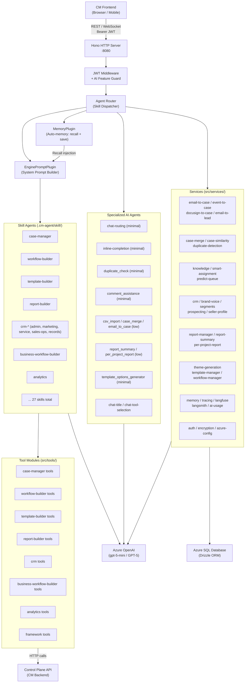
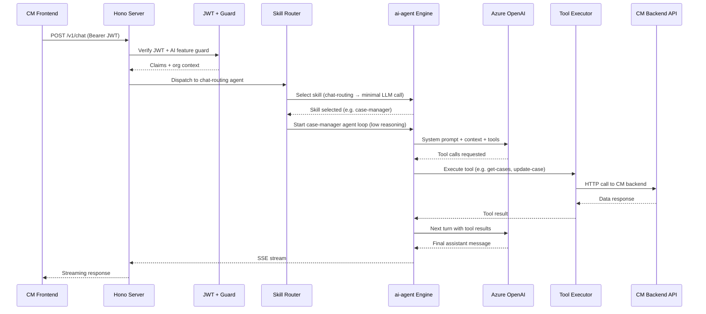
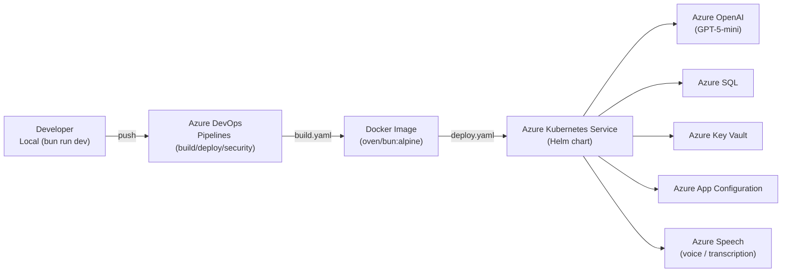

# CM AI Agent — High-Level Architecture Overview

> **Version:** 1.1.42 · **Runtime:** Bun · **Language:** TypeScript · **Framework:** `ai-agent` + Hono

---

## 1. What Is This?

**CM AI Agent** (`cmagent`) is a production AI-powered API server that acts as the intelligent backend for the **Case Manager (CM)** platform. It exposes a REST + WebSocket API consumed by the CM frontend, routes natural-language chat messages to the right AI skill, calls platform APIs as tools, and returns structured, streaming responses to the user.

The server sits between the CM UI and Azure-hosted LLMs (via the `ai-agent` framework), managing multi-turn conversations, skill dispatch, tool execution, long-term memory, and observability.

---

## 2. Technology Stack

| Layer | Technology |
|---|---|
| **Runtime** | [Bun](https://bun.sh) v1.3.10 |
| **Language** | TypeScript 6 |
| **HTTP Server** | [Hono](https://hono.dev) + Bun WebSocket |
| **AI Framework** | `ai-agent` (internal) |
| **LLM Provider** | Azure OpenAI (`avikto-default` → gpt-5-mini) |
| **Secondary Models** | Anthropic (claude-sonnet-4-6, claude-opus-4-6, claude-haiku-4-5) |
| **Database** | Azure SQL (via Drizzle ORM + migrations) |
| **Observability** | LangSmith, Langfuse |
| **Container** | Docker (Alpine + dumb-init) |
| **Infra / Deploy** | Kubernetes (Helm), Azure Pipelines |
| **Validation** | Zod |
| **Auth** | JWT (JOSE) |
| **Encryption** | Azure Key Vault |
| **Config** | Azure App Configuration |

---

## 3. High-Level Architecture



---

## 4. Project Structure

```
cm-ai-agent/
├── src/
│   ├── index.ts                   # App entrypoint — bootstrap, adapters, server start
│   ├── api/
│   │   ├── server/
│   │   │   ├── server.ts          # Hono app: middleware chain, all route registrations
│   │   │   ├── routes/            # 29 route modules (chat, crm, knowledge, voice …)
│   │   │   ├── ai-feature-guard.ts# Per-org AI feature on/off gate
│   │   │   ├── error.ts           # Centralised error shapes
│   │   │   └── network.ts         # TLS / hostname resolution
│   │   └── control-plane/
│   │       ├── caller.ts          # Authenticated HTTP client for CM backend
│   │       ├── org-context.ts     # Org-scoped request context adapter
│   │       ├── user-context.ts    # User-scoped request context adapter
│   │       ├── org-model.sql.ts   # Org-level model overrides (Drizzle)
│   │       └── request-context.ts # Shared context helpers
│   ├── services/                  # 60+ domain services (see §6)
│   └── tools/                     # Agent-callable tool sets (see §7)
│
├── .cm-agent/
│   ├── cmagent.jsonc              # Agent config: models, variants, skills, memory
│   ├── platform-context.md        # Domain hierarchy & interdependency rules injected into prompts
│   ├── skill/                     # 27 skill definitions (SKILL.md per domain)
│   ├── skill-registry.json        # Runtime skill index
│   └── url-registry.json          # CM API endpoint registry
│
├── migration/                     # Drizzle SQL migrations (timestamped, 17 migrations)
├── infra/
│   ├── kubernetes/                # Helm chart (dev + qat values)
│   └── config/                    # Environment-specific config files
├── pipelines/                     # Azure DevOps YAML (build, deploy, security)
├── scripts/                       # Developer utility scripts
├── test/                          # Bun test suite (40+ test files)
├── Dockerfile                     # Multi-stage Alpine build
├── package.json                   # Dependencies & scripts
└── tsconfig.json                  # TypeScript config
```

---

## 5. Request Lifecycle



---

## 6. Services Layer (`src/services/`)

Services are domain-scoped units that handle business logic, LLM calls, and data access. They are **not** directly HTTP-accessible — they are called by route handlers and tool executors.

| Group | Services |
|---|---|
| **Intake / Automation** | `email-to-case`, `event-to-case`, `docusign-to-case`, `email-to-lead` |
| **Case Intelligence** | `case-merge`, `case-similarity`, `duplicate-detection`, `smart-assignment`, `predict-queue` |
| **Knowledge** | `knowledge` (KB article search + embeddings) |
| **CRM** | `crm`, `brand-voice`, `segments`, `prospecting`, `seller-profile`, `entity-extraction` |
| **Reporting** | `report-manager`, `report-summary`, `per-project-report` |
| **Content Generation** | `theme-generation`, `template-manager`, `workflow-manager`, `business-workflow`, `comment-assistance`, `custom-field-assistance`, `ai-drafts`, `inline-completion` |
| **Session & Chat** | `chat-persistence`, `session-hygiene`, `session-share`, `preview-lifecycle`, `preview-save`, `preview-history` |
| **Memory** | `memory` (auto-save + semantic recall, 384-dim embeddings, 2000-token injection) |
| **Observability** | `tracing`, `langfuse`, `langsmith`, `ai-usage`, `analytics-manager`, `feedback` |
| **Infrastructure** | `auth`, `encryption`, `azure-config`, `llm`, `model-variant`, `org-model` |
| **Utilities** | `skill-registry`, `url-registry`, `terminology`, `tool-cache`, `voice`, `transcription`, `recommendations`, `record-brief` |

---

## 7. Tools Layer (`src/tools/`)

Tools are the agent's "hands" — TypeScript functions registered with the AI framework so the LLM can invoke them. Each tool group maps to a skill domain:

| Tool Group | Key Tools |
|---|---|
| **case-manager** | get/create/update/delete cases, tasks, documents, comments, dispatch, link, calendar events, search |
| **workflow-builder** | create/update/publish/delete workflows, get fields, queues, projects, surveys, history |
| **template-builder** | create/update/publish/delete templates, generate metadata, field types, recommendation tags |
| **report-builder** | create/update/delete/schedule/share reports, suggest charts, modify layouts |
| **crm** | entity & record CRUD, email, brand voice, drafts, insights, seller profile, chatbot, prospecting |
| **business-workflow-builder** | AI-assisted business process workflow construction |
| **analytics** | usage analytics, client fragments |
| **framework** | Core framework tool registration (register.ts) |

---

## 8. Skills (`.cm-agent/skill/`)

Skills are `SKILL.md`-driven capability definitions that tell the AI engine what domain it's operating in, what tools are available, and how to behave. The **chat-routing agent** selects the right skill per turn.

| Skill | Purpose |
|---|---|
| `case-manager` | Core case/project/task management, calendar, search |
| `case-query` | Read-only case lookups |
| `workflow-builder` | Automation workflow creation & editing |
| `template-builder` | Case template design |
| `report-builder` | Analytics reports & dashboards |
| `business-workflow-builder` | Business process workflows |
| `analytics` | Usage analytics & insights |
| `crm-admin` | CRM admin configuration |
| `crm-marketing` | CRM marketing campaigns |
| `crm-sales-ops` | CRM sales pipeline operations |
| `crm-service` | CRM customer service |
| `crm-records` | CRM contact/account record management |
| `crm-automations` | CRM automation rules |
| `email_to_case` | Inbound email → case creation |
| `event_to_case` | Calendar event → case creation |
| `email_to_lead` | Inbound email → CRM lead extraction |
| `docusign_to_case` | DocuSign envelope → case creation |
| `csv_import` | Bulk case import from CSV |
| `case_merge` | Duplicate case detection & merge |
| `comment_assistance` | AI-generated case comments |
| `custom_field_assistance` | AI-generated custom field content |
| `predict_queue` | ML-based queue recommendation |
| `duplicate_check` | Semantic duplicate detection |
| `report_summary` | Narrative report summaries |
| `per_project_report` | Executive project status reports |
| `template_options_generator` | Template field option generation |
| `platform-guide` | Onboarding & platform help |

---

## 9. AI Agent Configuration

The agent system is configured in [`.cm-agent/cmagent.jsonc`](../.cm-agent/cmagent.jsonc) and uses a **reasoning-effort tiering** strategy:

| Tier | Used For | Effort |
|---|---|---|
| `minimal` | Routing, inline completion, title gen, options gen, duplicate check | Fastest / cheapest |
| `low` | Case manager, intake agents, merge, reports | Balanced |
| `medium` | (available, reserved) | — |
| `high` | (available, reserved) | Maximum |

**Memory:** Auto-save enabled on every turn and compaction. Up to 2,000 tokens of semantic memory are injected per turn. Scoped to org + user.

**Compaction:** Auto-compaction with pruning to manage long conversation histories within the 400K context window.

---

## 10. API Surface

The server listens on **port 8080** and exposes OpenAPI documentation at `/doc`.

| Route Prefix | Domain |
|---|---|
| `GET /health` | Health check |
| `POST /v1/chat` | Main SSE chat endpoint (streaming) |
| `GET/POST /v1/chat/preview` | Preview & confirm tool actions |
| `GET /v1/preview` | Preview history |
| `GET/POST /v1/chat/*` | Chat history & session management |
| `POST /v1/skill` | Single-turn skill execution |
| `POST /csv` | CSV import |
| `GET/PUT /v1/org` | Org-level model configuration |
| `POST /v1/feedback` | Message feedback / Langfuse scoring |
| `GET /v1/usage` | AI usage analytics |
| `GET/POST /v1/voice` | Voice dictation, Azure Speech tokens |
| `POST /v1/theme` | Theme generation from description/logo |
| `POST /v1/inline-completion` | Text box autocomplete |
| `GET/POST /v1/crm/*` | CRM entity, record, email, brand voice, drafts, insights, chatbot, prospecting |
| `GET/POST /v1/knowledge` | Knowledge base article search |
| `/session`, `/permission`, `/question`, `/provider` | Framework internals |

**Auth:** All endpoints require a signed JWT Bearer token. The chatbot widget's public message endpoint is the sole exception.

---

## 11. Database Migrations

Managed with **Drizzle Kit** (`bun db`). Migrations live in `/migration/` as timestamped directories:

| Migration | Description |
|---|---|
| `20260101000000_initial` | Base schema |
| `20260507000000_case_embeddings_smart_assignment` | Smart assignment vector columns |
| `20260508000000_email_case_metadata` | Email-to-case metadata |
| `20260511000000_docusign_case_metadata` | DocuSign metadata |
| `20260521000000_feedback` | User feedback tables |
| `20260522000000_feedback_embeddings` | Feedback vector embeddings |
| `20260603000000_message_preview_metadata` | Preview state metadata |
| `20260604000000_preview_lifecycle_finalized` | Preview lifecycle |
| `20260617000000_event_to_case_mappings` | Calendar → case field mappings |
| `20260717000000_memory_tables` | Long-term memory (vector 384-dim) |
| `20260720000000_ai_usage` | AI cost/token tracking |
| `20260804000000_business_workflow_draft` | Business workflow draft state |
| `20260805000000_crm_capabilities` | CRM feature tables |
| `20261013000000_session_share_token` | Session sharing tokens |
| `20261014000000_prospecting_research` | Sales prospecting data |
| `20261015000000_seller_profile` | Seller profile storage |
| `20261030000000_kb_article_embeddings` | Knowledge base article vectors |

---

## 12. Infrastructure & Deployment



- **Build:** Multi-stage Dockerfile (deps stage → production stage), Alpine base.
- **Process management:** `dumb-init` as PID 1 for proper signal handling.
- **Health check:** `GET /health` polled every 30s.
- **Environments:** `dev` and `qat` Helm value files in `infra/kubernetes/`.

---

## 13. Developer Quick Reference

```bash
# Install dependencies
bun install

# Run locally (hot-reload)
bun run dev

# Type check
bun run typecheck

# Run tests
bun test

# Database migrations
bun run db migrate

# Build Docker image
docker build --build-arg REGISTRY_TOKEN=<token> -t cmagent .
```

**Key environment variables:**

| Variable | Purpose |
|---|---|
| `PORT` | HTTP port (default: 8080) |
| `HOST` | Bind address (default: 127.0.0.1) |
| `CMAGENT_CHANNEL` | Set to `local` for dev logging |
| `CMAGENT_LOG_TOOL_REGISTRY` | Set to `1` to enable tool-resolution timing logs |
| `LANGSMITH_API_KEY` | Enable LangSmith tracing |

---

## 14. Key Design Decisions

| Decision | Rationale |
|---|---|
| **Bun over Node.js** | Faster startup, native TypeScript, built-in test runner |
| **`snapshot: false`** | No git snapshots — API server never edits files; removing this cut per-step latency by 30–50 s |
| **Reasoning-effort variants** | Fine-grained cost control: route with `minimal`, act with `low`; reserve `high` for future complex tasks |
| **Auto-memory** | Persistent user context across sessions without explicit memory commands |
| **Skill-based routing** | ~176 tools total, loaded lazily per skill to avoid context bloat and reduce model confusion |
| **Azure alias (`avikto-default`)** | Decouples model deployment name from real model name; swap the model in Azure without touching code |
| **LangSmith + Langfuse dual tracing** | LangSmith for development & debugging; Langfuse for production scoring & feedback loop |

---

*Last updated: 2026-11-17*
